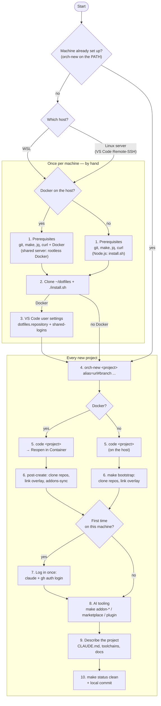
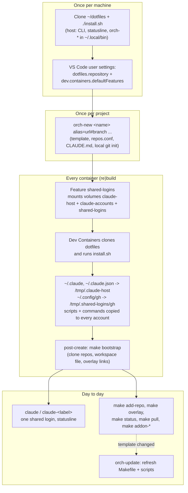

# dotfiles

Shared Claude Code tooling: enriched statusline, multi-account switching
aliases, custom slash commands, and CLI/ccstatusline/gh auto-install. Installed
via `install.sh`, which is idempotent — safe to re-run any time (e.g. after
pulling a change) to re-propagate everything below. It also provides the
**orchestrator template** every project starts from.

## Start here

From a bare machine to a working project. The machine is **WSL** or a **Linux server**,
each with or without Docker, always used through **VS Code** (on a server via Remote-SSH).
If the machine is already set up, jump straight to the project steps.



### Once per machine (skip if `orch-new` already works)

Full details: [`new-machine/README.md`](new-machine/README.md).

1. **Host prerequisites** — `git make jq curl`, plus:
   - **with Docker**: Docker Engine (or Docker Desktop with WSL integration) with your user in
     the `docker` group; on a shared Linux server, rootless Docker instead;
   - **without Docker**: Node.js (npm) on the host, for `ccstatusline` and the AI add-ons —
     `install.sh` installs the latest LTS in `~/.local/node` if `npm` is missing.

   → [new-machine §1](new-machine/README.md#1-prerequisites-on-the-host)
2. **dotfiles** — `git clone https://github.com/rox70/dotfiles ~/dotfiles && cd ~/dotfiles && ./install.sh && source ~/.bashrc`,
   then `which orch-new` must succeed. Exactly one clone per machine
   ([why](#one-clone-per-machine--never-two)).
   → [new-machine §2](new-machine/README.md#2-dotfiles-on-the-host)
3. **VS Code user settings** (with Docker only) — `dotfiles.repository` and
   `dev.containers.defaultFeatures` with `shared-logins`, so every devcontainer gets the
   dotfiles and the shared logins. Without Docker there are no devcontainers: skip it.
   → [new-machine §3](new-machine/README.md#3-vs-code-user-settings-vs-code-hosts-only)

### Updating (after a change to this repo)

On the **host of every machine** that has the clone, pull and re-run the installer:

```bash
git -C ~/dotfiles pull --ff-only
cd ~/dotfiles && ./install.sh
```

- **Pull first.** `install.sh` refuses to run from a checkout behind `origin`
  ([why](#what-installsh-does)): an old copy would put old scripts and commands back.
- **Re-running is safe**: `install.sh` is idempotent and only redoes what is needed. It
  should end with `Dotfiles and Claude CLI installed successfully.`; any
  `[dotfiles] WARNING` is repeated in a summary at the end.
- **Have Docker running**, so the step that creates the `shared-logins` volumes runs
  instead of warning.
- **Devcontainers need nothing**: Dev Containers clones the current dotfiles and runs
  `install.sh` on every container (re)build. To pick up a change in an open container,
  rebuild it.
- **Projects**: the `orch-*` commands are symlinks into the clone, so the pull updates them.
  A project's own copy of the template scripts is refreshed separately, with `orch-update`
  (see [`orchestrator/README.md`](orchestrator/README.md)).

### Every new project

Full checklist: [`orchestrator/README.md` → Create a project](orchestrator/README.md#create-a-project).

4. **Scaffold** on the host: `cd ~/source/repos && orch-new <project> <alias>=<git-url>#<branch> ...`
5. **Open it in VS Code** — `code <project>` (on a server, from a Remote-SSH window):
   - **with Docker**: *Reopen in Container*. A build failing on a Feature is usually a failed
     download: rebuild (`orch-up --rebuild <project>` shows the full build log in a terminal,
     see [Without VS Code](orchestrator/README.md#without-vs-code-orch-up--orch-shell));
   - **without Docker**: work directly on the host.
6. **Repos and overlay**:
   - **with Docker**: the post-create runs by itself — clones the child repos, links the
     overlay, reinstalls the add-ons of `addons.conf`;
   - **without Docker**: run `make bootstrap` (clones the child repos, links the overlay);
     after changing `addons.conf`, `make addons-sync`.
7. **First time on this machine only** — log in once with `claude` and `gh auth login`
   (with Docker: in the first devcontainer, and every other container and rebuild reuses the
   logins; without Docker: on the host).
   → [new-machine §5](new-machine/README.md#5-claude-code-login-and-personal-settings),
   [§6](new-machine/README.md#6-github-cli-login)
8. **AI tooling** — `make addon-openspec`, `make marketplace ...`, `make plugin ...`.
   → [orchestrator: Optional AI tooling](orchestrator/README.md#optional-ai-tooling-add-ons)
9. **Describe the project** — repo roles in `CLAUDE.md`, toolchains in
   `.devcontainer/devcontainer.json` (with Docker) or on the host (without), `docs/`,
   `contracts/`, `harness/`.
10. **Check and save** — `make status` shows no AI files in the child repos; commit the
    orchestrator's changes in its local git.

Day-to-day commands (`make add-repo`, `make overlay`, `make pull`, `orch-update`, …):
[`orchestrator/README.md` → Day to day](orchestrator/README.md#day-to-day-inside-the-orchestrator).

## How it fits together

What happens behind the steps above, and where each piece lives:



From a terminal, without VS Code, `orch-up` / `orch-shell` replace the user settings and
"Reopen in Container" (see
[`orchestrator/README.md`](orchestrator/README.md#without-vs-code-orch-up--orch-shell)). The pieces in detail: the shared login below, the template in
[`orchestrator/README.md`](orchestrator/README.md), the Feature in
[`features/README.md`](features/README.md), a new machine in
[`new-machine/README.md`](new-machine/README.md).

## What this repo provides

- **Enriched statusline** (`claude/scripts/statusline-wrapper.sh`, wired via
  `claude/settings.json`'s `statusLine`) — one line combining:
  - active account: the label registered for the logged-in email in
    `~/.claude/account-labels` (`claude_account_add` / `claude_account_label`),
    an email never seen is added automatically with no label and shown as is; set
    one with `/account-label <label>` in Claude Code or `claude_account_label
    <label> [email]` in a shell, rename one with `/account-label <old> <new>` /
    `claude_account_rename <old> <new>` (`claude_account_list` shows them all);
    before login, the profile directory name (`default` for the default account)
  - current model name (`claude-sonnet-5` → "Sonnet 5", etc.)
  - 5h and 7-day rate-limit usage %, color-coded (green/cyan/orange/red by
    threshold) with each window's reset time in `STATUSLINE_TZ` (local time if unset)
  - git info for the cwd (repo, branch, staged/unstaged/untracked counts —
    `claude/scripts/statusline-command.sh`)
  - context window usage (via `ccstatusline/settings.json`, `context-length` +
    `context-percentage` segments)
  - a **separate** subagent statusline (`claude/scripts/subagent-statusline.sh`,
    `subagentStatusLine`) — one row per task in the agent panel, each with its
    own model (a dispatched subagent can run a different model than the
    parent session).
- **Multi-account switching aliases** (`claude/scripts/claude-accounts.sh`) —
  see "Multiple accounts" below: `claude-<label>` for the default account
  (the label of its login email in `~/.claude/account-labels`), plus one
  `claude-<name>` alias per discovered account directory, each just setting
  `CLAUDE_CONFIG_DIR` before running `claude`.
- **Custom slash commands** (`claude/commands/*.md`) — currently
  `/account-label` (set or rename the statusline label of an account). Drop
  any new `.md` file in that directory and `install.sh` propagates it to
  every account (see "Multiple accounts" below); to remove one, delete it
  and add its file name to `RETIRED_COMMANDS` in `install.sh`, which then
  deletes it from every account.
- **Auto-install of the Claude Code CLI** via the official native installer
  (npm as fallback when `curl` is missing), of `ccstatusline` via npm, and of
  the GitHub CLI (`gh`).
- **Cross-project login persistence** — see "Cloning this repo onto a new
  environment" below.
- **Orchestrator template** (`orchestrator/`) — `orch-new` scaffolds the
  local, devcontainer-based workspace every project starts from (AI harness,
  docs, contracts, child repos cloned inside it); `orch-update` refreshes its
  generic scripts later; `orch-up` / `orch-shell` run it without VS Code.
  See `orchestrator/README.md`.

## What `install.sh` does

Outside a container everything stays inside the user's profile: no sudo, no
system packages, no shared `/tmp` paths (safe for any user of a shared
server). Inside a devcontainer it may use the container's package manager and
the `/tmp/.claude-*` and `/tmp/.shared-logins` mount points of the `shared-logins` Feature.

- Refuses to run from a checkout that is behind `origin`'s default branch
  (`git fetch` first; an unreachable remote only warns). In a container
  `~/.claude` is the volume shared by every devcontainer, so an old
  `install.sh` would put old scripts and commands back for all of them. Run
  `git pull` first, or `DOTFILES_ALLOW_STALE=1 ./install.sh` on purpose.
- Installs the Claude Code CLI if missing (native installer, npm fallback)
  and `ccstatusline` via npm (under `~/.local` when the global npm prefix is
  not writable); checks `jq`/`npm` first, installs `jq` (container: package
  manager; host: static binary in `~/.local/bin`), installs Node.js when `npm`
  is missing (latest LTS from the official nodejs.org tarball, checksum-verified,
  into `~/.local/node`, with `~/.local/node/bin` added to `PATH`; an existing
  Node — system, nvm, a devcontainer Feature — is never touched or upgraded),
  installs the GitHub CLI
  (`gh`, official release binary in `~/.local/bin`) if missing, and reports anything
  missing in a final warning summary.
- Copies `claude/scripts/*.sh` into `~/.claude/scripts/` and
  `claude/commands/*.md` into `~/.claude/commands/` — **for every Claude Code
  account on the machine**, not just the default one (see "Multiple accounts"
  below).
- Merges `claude/settings.json` (statusline config) into `~/.claude/settings.json`.
- Creates `~/.claude/dotfiles.conf` (personal settings, never in this repo) on
  first run: `STATUSLINE_TZ`. Its initial value can be passed as an env var to
  `install.sh`. Account labels are not settings: see "Multiple accounts".
  In a container it lands in the shared `claude-host` volume, so it is set
  once for every devcontainer.
- Symlinks `orchestrator/bin/orch-*` into `~/.local/bin` and makes sure
  `~/.local/bin` is on `PATH`.
- Adds the `claude-accounts.sh` source line to `~/.bashrc`, `~/.zshrc`, and
  `~/.profile` (the last one so login shells using `/bin/sh` pick it up too).
- On a host with a running Docker engine: creates the `shared-logins` Feature's
  volumes (`claude-host`, `claude-accounts`, `shared-logins`) if missing, so a
  compose-based devcontainer, which declares them `external`, can start even
  when it is the first devcontainer opened on that engine.
- In a container: symlinks `~/.claude` and `~/.claude.json` to the mounted
  `/tmp/.claude-host`, if present. On a host: only to `~/.claude-host`, never
  to `/tmp` (another user could have created it).

## User-agnostic by design

Nothing in this repo hardcodes a user name or home directory: the same
checkout works for any user on any machine (e.g. one user on a local WSL
host, a different one on a shared Linux server).
- Scripts resolve paths from `$HOME` and from the checkout's own location.
- Command files reference this repo through the `__DOTFILES_DIR__`
  placeholder, which `install.sh` replaces with the real checkout path when
  it copies them into each account.
- Personal values live outside the scripts: the time zone in
  `~/.claude/dotfiles.conf`, account labels in `~/.claude/account-labels`.
- In a devcontainer the repo is cloned by Dev Containers (`dotfiles.repository`,
  or `orch-up` without VS Code); on a host it lives at `~/dotfiles`.
- If a devcontainer already persists `~/.claude` in its own named volume,
  `install.sh` detects the mountpoint and leaves it alone instead of linking
  it to `.claude-host`.

## Shared login for every devcontainer (no project file touched)

Dev Containers has no user-level "default mounts" setting, but it does have
`dev.containers.defaultFeatures`, and a Feature may declare mounts of Docker
**named volumes** (not host bind paths). The `shared-logins` Feature
(`features/src/` in this repo, published by `.github/workflows/publish-features.yml`
as the **public** package `ghcr.io/rox70/dotfiles/shared-logins`: Dev Containers
pulls it without auth; see `features/README.md`), is such
a Feature: it mounts the volumes `claude-host` at `/tmp/.claude-host`
and `claude-accounts` at `/tmp/.claude-accounts`, which `install.sh` then
links to `~/.claude` / `~/.claude.json` and turns into `claude-<name>`
aliases, and `shared-logins` at `/tmp/.shared-logins`, one subdirectory per
other CLI (`gh` today), which `install.sh` links to that tool's config
directory (`~/.config/gh`). Another tool only needs one more link in
`install.sh`, not a new Feature version. Every devcontainer on the same Docker engine shares them, and no
team-shared `devcontainer.json` / compose file needs editing -- except in a compose-based
devcontainer, which needs a one-time, inert hook committed by the project plus a gitignored
override you fill in locally (see
[`features/README.md`](features/README.md#compose-based-devcontainers-a-local-override-is-needed)).

Add to your VS Code **User** settings, next to the `dotfiles.*` ones:

```json
"dev.containers.defaultFeatures": {
  "ghcr.io/rox70/dotfiles/shared-logins:1": {}
}
```

It replaces the older `claude-shared-login` Feature: never list both (same
mount targets). The Claude volumes keep their names, so switching keeps the
login.

- **Credentials never enter this repo**: the Feature only names the volumes;
  tokens live inside them, on the Docker engine's disk.
- Log in once per tool and account: `gh auth login`, and `claude` (default) in any container; for another
  account just `claude-<label> [email]`: with nothing set up it creates the
  default profile labelled `<label>`, otherwise an extra profile `<label>`; it
  logs it in (email pre-filled when given) and registers the login email under
  `<label>` (see [`new-machine/README.md`](new-machine/README.md#5-claude-code-login-and-personal-settings)).
- Import an existing login instead of logging in again:
  `scripts/login-volumes.sh seed <existing-claude-config-volume>`.
- Back up / restore the volumes from the **host** shell (e.g. WSL):
  `scripts/login-volumes.sh backup|restore`, to
  `~/.claude-login-backup/` (mode 700, never inside a repo).
- Security: those tokens are mounted into *every* devcontainer you open,
  so any code a project runs there can read them.
- A container that already persists `~/.claude` in its own volume keeps it
  (`install.sh` detects the mountpoint), so it stays on a separate login.
- Changing the Feature: see the release steps in that repo's README, then
  bump the tag in the settings URL. Its volume names and mount targets must
  stay in sync with `install.sh` and `claude/scripts/claude-accounts.sh`.

## Setting up a new machine

The steps are summarised in [Start here](#start-here);
[`new-machine/README.md`](new-machine/README.md) is the full procedure for any Linux host —
WSL on another PC, another user, a Linux server with or without VS Code, or a host
without Docker: host prerequisites, one `~/dotfiles` clone + `install.sh`,
the two VS Code user settings (or `orch-up` on a headless server), login and personal
settings.

### One clone per machine — never two

If a machine already has this repo bind-mounted or cloned at a canonical path
(e.g. a devcontainer mounting the host's own checkout), and you also want a
shorter `~/dotfiles` alias to it, that alias **must** be a symlink
(`ln -s <canonical-path> ~/dotfiles`) — **never a second `git clone`**. Two
independent clones of the same repo silently drift apart: uncommitted work in
one is invisible to the other, and whichever one `install.sh` doesn't
actually run from goes stale. This already happened once and took real effort
to reconcile. The per-container clones made by Dev Containers are disposable
copies: change this repo from the host clone (or push right away from a
container, before any rebuild).

## Multiple accounts

`claude/scripts/claude-accounts.sh` defines one shell alias per Claude Code
account found in:
- `.devcontainer/.claude-<name>/` under the current project (per-project,
  container only), and
- `/tmp/.claude-accounts/<name>/` (global, container) or
  `~/.claude-accounts/<name>/` (global, bare host fallback).

`install.sh` propagates every custom command in `claude/commands/` into
**each** of those account directories, plus the default `~/.claude` — not
just the default. If you add a new command file, re-run `install.sh` (or
just `claude-<name>` a fresh session — commands are resolved at session
start) to make it show up everywhere.
